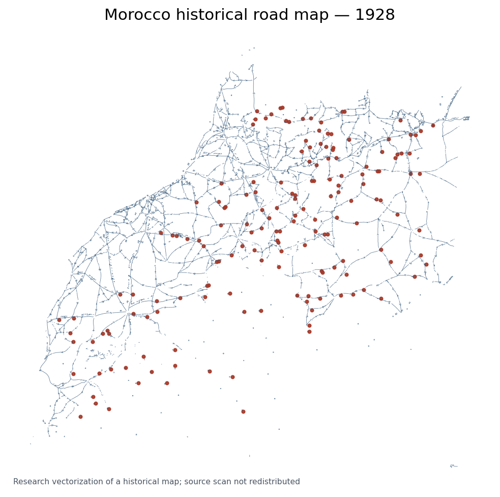
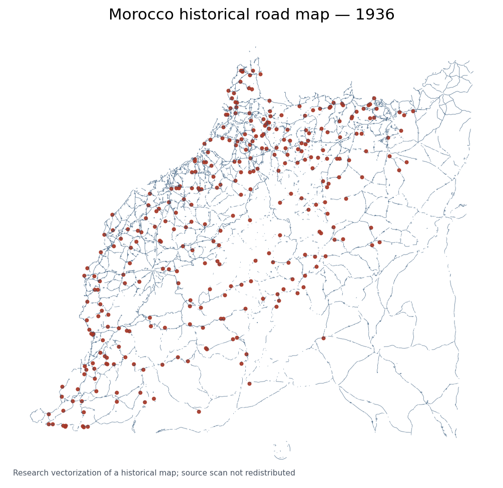
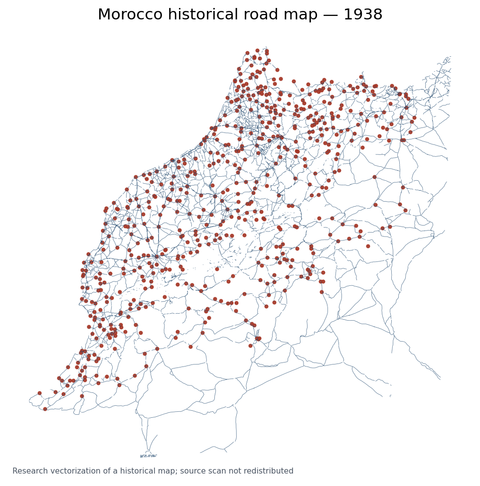

# Cartes routières historiques du Maroc, 1922–1938

[English version](README.md)

Ce dépôt de recherche publie une représentation géographique harmonisée des routes et des localités extraites de six cartes historiques du Maroc : 1922, 1925, 1928, 1934, 1936 et 1938. Il présente les produits cartographiques retenus sous la forme d’un paquet autonome et documenté.

## Contenu

- les six reproductions JPEG originales immuables, chacune reliée à sa notice BnF et à son objet Gallica exacts ;
- six GeoPackages vectoriels contenant les routes et les localités alignées sur les JPEG originaux au moyen de fichiers de calage d'un pixel ;
- un GeoPackage réunissant douze couches géographiques : routes et localités pour chaque millésime ;
- un projet QGIS unique réunissant les contrôles sur image source et les couches géographiques des six millésimes ;
- une synthèse scientifique, un dictionnaire des données et un registre des sources et droits ;
- les scripts et réglages annuels utiles à la compréhension et à la reproduction ;
- une vue vectorielle de chaque millésime ;
- un manifeste reliant chaque couche publique à sa source privée contrôlante par empreinte SHA-256.

Les extraits OpenStreetMap, le catalogue GeoNames complet, l’environnement Python embarqué, les fichiers intermédiaires et les grands GeoPackages privés de reconstruction ne sont pas redistribués. Les scans historiques et les GeoPackages raster minimaux nécessaires au contrôle de l'extraction sur l'image source sont inclus.

## Statut scientifique

La carte de 1922, routes comprises, a été explicitement validée par le chercheur principal. Les couches 1925 et 1938 réunissent des objets validés humainement et des objets classés automatiquement. Les inventaires de localités de 1928, 1934 et 1936 restent des candidats automatiques et ne constituent pas des validations humaines objet par objet. La [synthèse scientifique](docs/SCIENTIFIC_OVERVIEW.fr.md) expose précisément ces différences.

Le nombre d’objets routiers est un nombre de géométries vectorielles, non un nombre de routes historiques distinctes. Certaines interruptions graphiques sont représentées par des raccordements admis selon les règles annuelles. Une différence entre millésimes ne peut pas être interprétée comme une évolution historique sans distinguer les changements réels des différences de graphisme, de couverture et de détection.

## Galerie des cartes

| 1922 | 1925 | 1928 |
|---|---|---|
|  |  |  |

| 1934 | 1936 | 1938 |
|---|---|---|
|  |  |  |

## Ouvrir les cartes

1. Télécharger ou cloner le dépôt.
2. Ouvrir [MOROCCO_HISTORICAL_MAPS_1922_1938.qgz](qgis/MOROCCO_HISTORICAL_MAPS_1922_1938.qgz) avec QGIS 3.44 ou une version récente compatible.
3. Pour contrôler l'extraction sur un scan, activer **Source images — control in pixel coordinates**, puis le sous-groupe d'un millésime. Les lignes cyan et les points jaunes se superposent directement au raster original.
4. Pour comparer les millésimes dans l'espace géographique, activer un ou plusieurs groupes annuels géographiques.

Le projet lit les six GeoPackages vectoriels placés dans [data/source_image_control](data/source_image_control), les JPEG originaux placés dans [sources/original_scans](sources/original_scans) et [morocco_historical_maps_1922_1938.gpkg](data/morocco_historical_maps_1922_1938.gpkg). Il ne dépend pas de l’archive privée. Le très grand JPEG de 1938 est affiché par une dérivée QGIS tuilée afin d'éviter la limite mémoire du décodeur ; le JPEG immuable reste la source contrôlante.

## Du scan original à QGIS

Le [manifeste des originaux](sources/ORIGINAL_SCAN_MANIFEST.csv) identifie chaque scan par son empreinte SHA-256, ses dimensions, l'ARK de la notice BnF, l'ARK de l'objet Gallica, sa cote et l'attribution requise. Le [guide des sources](sources/README.md) explique les quatre étapes contrôlables : JPEG immuable, raster aligné dans QGIS, vecteurs en coordonnées-image et vecteurs géographiques. Un lecteur peut ainsi vérifier ce qui a été extrait de l'image historique avant d'utiliser les couches spatiales harmonisées.

## Documentation

- [Synthèse scientifique](docs/SCIENTIFIC_OVERVIEW.fr.md)
- [Dictionnaire des données](docs/DATA_DICTIONARY.md)
- [Guide de reproductibilité](docs/REPRODUCIBILITY.md)
- [Sources, droits et attributions](SOURCES_AND_RIGHTS.md)
- [Scans originaux et guide original-vers-QGIS](sources/README.md)
- [Manifeste de provenance des scans](sources/ORIGINAL_SCAN_MANIFEST.csv)
- [Comptes et filiation des couches](data/LAYER_SUMMARY.csv)
- [Manifeste de publication](PUBLICATION_MANIFEST.json)

## Citation et licences

La citation recommandée figure dans [CITATION.cff](CITATION.cff). Le code placé sous `code/` est diffusé sous [licence MIT](LICENSE-CODE.md). Les données vectorielles dérivées, le projet QGIS, les aperçus, les configurations et la documentation sont diffusés sous [CC BY-NC 4.0](LICENSE-DATA.md), sous réserve des obligations propres aux sources consignées dans [SOURCES_AND_RIGHTS.md](SOURCES_AND_RIGHTS.md). Les six scans et leurs copies raster incorporées sont exclus de cette licence et restent régis par les conditions d'utilisation de Gallica précisées dans leur manifeste.
