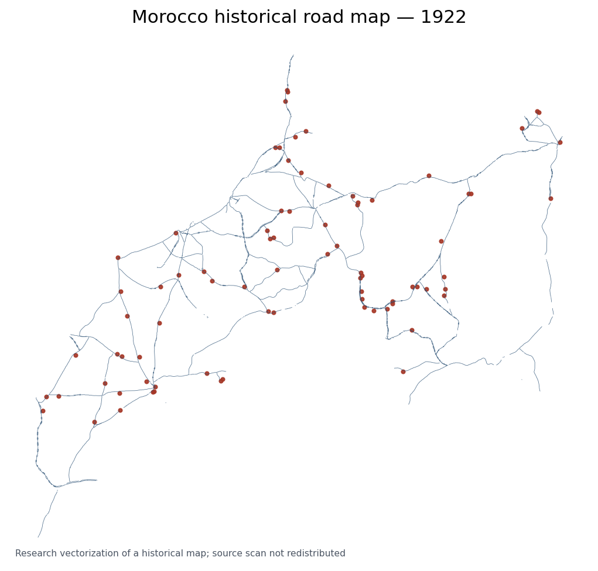
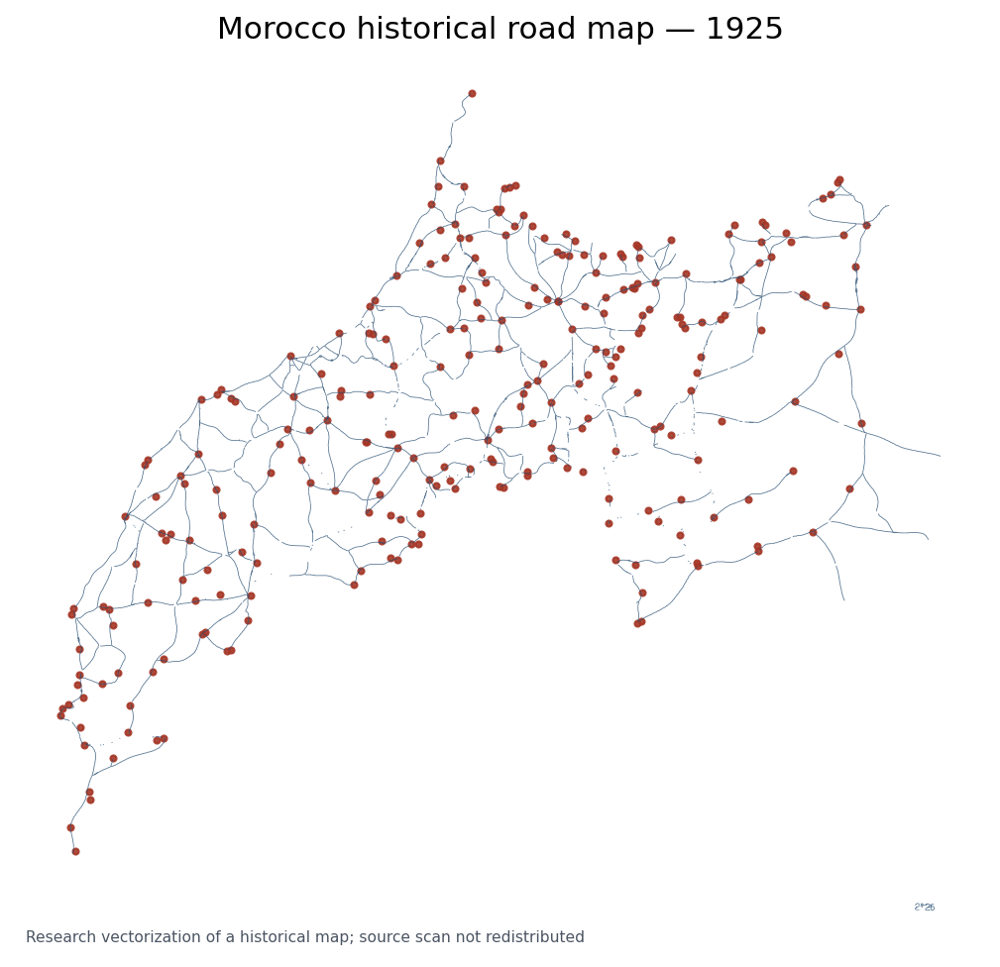
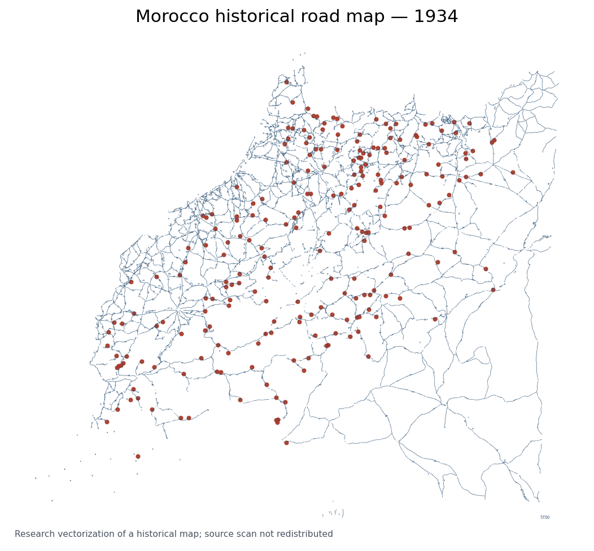

# Cartes routières historiques du Maroc, 1922–1938

[English version](README.md)

Ce dépôt de recherche publie une représentation géographique harmonisée des routes et des localités extraites de six cartes historiques du Maroc : 1922, 1925, 1928, 1934, 1936 et 1938. Il présente les produits cartographiques retenus sous la forme d’un paquet autonome et documenté.

## Contenu

- un GeoPackage réunissant douze couches géographiques : routes et localités pour chaque millésime ;
- un projet QGIS unique organisé en six groupes annuels ;
- une synthèse scientifique, un dictionnaire des données et un registre des sources et droits ;
- les scripts et réglages annuels utiles à la compréhension et à la reproduction ;
- une vue vectorielle de chaque millésime ;
- un manifeste reliant chaque couche publique à sa source privée contrôlante par empreinte SHA-256.

Les scans historiques, les extraits OpenStreetMap, le catalogue GeoNames, l’environnement Python embarqué, les fichiers intermédiaires et les GeoPackages contenant les rasters ne sont pas redistribués.

## Statut scientifique

La carte de 1922, routes comprises, a été explicitement validée par le chercheur principal. Les couches 1925 et 1938 réunissent des objets validés humainement et des objets classés automatiquement. Les inventaires de localités de 1928, 1934 et 1936 restent des candidats automatiques et ne constituent pas des validations humaines objet par objet. La [synthèse scientifique](docs/SCIENTIFIC_OVERVIEW.fr.md) expose précisément ces différences.

Le nombre d’objets routiers est un nombre de géométries vectorielles, non un nombre de routes historiques distinctes. Certaines interruptions graphiques sont représentées par des raccordements admis selon les règles annuelles. Une différence entre millésimes ne peut pas être interprétée comme une évolution historique sans distinguer les changements réels des différences de graphisme, de couverture et de détection.

## Galerie des cartes

| 1922 | 1925 | 1928 |
|---|---|---|
|  |  |  |

| 1934 | 1936 | 1938 |
|---|---|---|
|  |  |  |

## Ouvrir les cartes

1. Télécharger ou cloner le dépôt.
2. Ouvrir [MOROCCO_HISTORICAL_MAPS_1922_1938.qgz](qgis/MOROCCO_HISTORICAL_MAPS_1922_1938.qgz) avec QGIS 3.44 ou une version récente compatible.
3. Activer un ou plusieurs groupes annuels. Le groupe 1938 est visible à l’ouverture.

Le projet lit [morocco_historical_maps_1922_1938.gpkg](data/morocco_historical_maps_1922_1938.gpkg), qui contient les douze couches sans dépendre de l’archive privée.

## Documentation

- [Synthèse scientifique](docs/SCIENTIFIC_OVERVIEW.fr.md)
- [Dictionnaire des données](docs/DATA_DICTIONARY.md)
- [Guide de reproductibilité](docs/REPRODUCIBILITY.md)
- [Sources, droits et attributions](SOURCES_AND_RIGHTS.md)
- [Comptes et filiation des couches](data/LAYER_SUMMARY.csv)
- [Manifeste de publication](PUBLICATION_MANIFEST.json)

## Citation et licences

La citation recommandée figure dans [CITATION.cff](CITATION.cff). Les licences finales du code et des données doivent être confirmées avant le passage du dépôt privé de préparation au dépôt public ; voir [LICENSE_PENDING.md](LICENSE_PENDING.md). Les obligations propres aux sources sont documentées dans [SOURCES_AND_RIGHTS.md](SOURCES_AND_RIGHTS.md).
