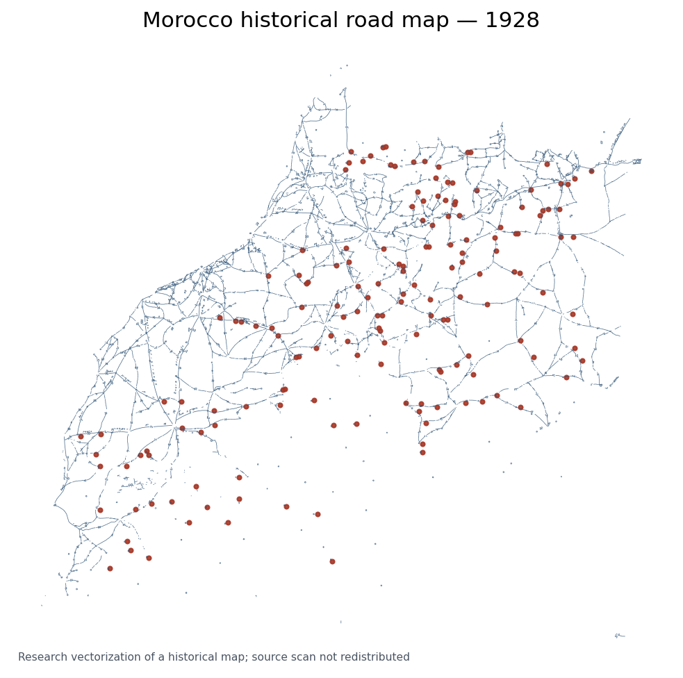

# Morocco historical road maps, 1922–1938

[Version française](README.fr.md)

This research repository publishes a harmonized geographic representation of roads and localities extracted from six historical maps of Morocco: 1922, 1925, 1928, 1934, 1936 and 1938. It is designed to make the retained cartographic products understandable and reusable as a self-contained package.

## What is included

- the six immutable original JPEG reproductions, each linked to its exact BnF notice and Gallica object;
- six source-image vector GeoPackages containing road lines and localities aligned to the original JPEGs through one-pixel world files;
- one GeoPackage containing twelve geographic layers: roads and localities for each year;
- one QGIS project that opens both the source-image controls and the geographic layers for all six years;
- a concise scientific overview, data dictionary and source-rights register;
- the scripts and annual settings needed to understand and reproduce the transformations;
- one vector preview per year;
- a manifest linking every public layer to its controlling private source by SHA-256 hash.

OpenStreetMap extracts, the complete GeoNames dump, the embedded Python environment, intermediate files and the large private reconstruction GeoPackages are not redistributed. The historical scans and the minimal raster-bearing GeoPackages required to audit extraction against the source images are included.

## Scientific status

The 1922 map, including its roads, was explicitly validated by the principal investigator. The public layers for 1925 and 1938 combine human-validated objects with automatically classified objects. The 1928, 1934 and 1936 locality inventories remain automatically generated candidates rather than object-by-object human validations. These statuses are carried in the public data and explained in [the scientific overview](docs/SCIENTIFIC_OVERVIEW.md).

The road layer count is a count of vector objects, not a count of historically distinct roads. Some map interruptions are represented by admitted connectors according to the annual rules. The repository does not treat differences in map design, coverage or detection performance as historical change without further analysis.

## Map gallery

| 1922 | 1925 | 1928 |
|---|---|---|
|  |  |  |

| 1934 | 1936 | 1938 |
|---|---|---|
|  |  |  |

## Open the maps

1. Download or clone the repository.
2. Open [MOROCCO_HISTORICAL_MAPS_1922_1938.qgz](qgis/MOROCCO_HISTORICAL_MAPS_1922_1938.qgz) in QGIS 3.44 or a compatible recent version.
3. To audit extraction against a scan, enable **Source images — control in pixel coordinates**, then enable one annual subgroup. Its cyan lines and yellow points are drawn directly over the original raster.
4. To compare years geographically, enable one or more of the annual geographic groups.

The project reads the six source-image vector GeoPackages under [data/source_image_control](data/source_image_control), the original JPEGs under [sources/original_scans](sources/original_scans), and [morocco_historical_maps_1922_1938.gpkg](data/morocco_historical_maps_1922_1938.gpkg). It does not require the private source archive. The very large 1938 JPEG is displayed through a tiled QGIS derivative to avoid decoder memory limits; the immutable JPEG remains the controlling source.

## Original-to-QGIS audit trail

The [original-source manifest](sources/ORIGINAL_SCAN_MANIFEST.csv) identifies every scan by SHA-256 digest, pixel dimensions, BnF catalogue ARK, Gallica ARK, shelf mark and required attribution. The [source guide](sources/README.md) explains the four inspectable stages: immutable JPEG, aligned QGIS raster, source-image vectors and geographic vectors. This separation lets a reader verify what was read from the historical image before using the harmonized spatial layers.

## Documentation

- [Scientific overview](docs/SCIENTIFIC_OVERVIEW.md)
- [Data dictionary](docs/DATA_DICTIONARY.md)
- [Reproducibility guide](docs/REPRODUCIBILITY.md)
- [Sources, rights and attribution](SOURCES_AND_RIGHTS.md)
- [Original scans and original-to-QGIS guide](sources/README.md)
- [Original scan provenance manifest](sources/ORIGINAL_SCAN_MANIFEST.csv)
- [Layer counts and lineage](data/LAYER_SUMMARY.csv)
- [Publication manifest](PUBLICATION_MANIFEST.json)

## Citation and licensing

A citation file is included in [CITATION.cff](CITATION.cff). Code under `code/` is released under the [MIT License](LICENSE-CODE.md). The derived vector data, QGIS project, previews, configurations and documentation are released under [CC BY-NC 4.0](LICENSE-DATA.md), subject to the source-specific attribution requirements in [SOURCES_AND_RIGHTS.md](SOURCES_AND_RIGHTS.md). The six scans and their embedded raster copies are excluded from that licence and remain governed by the Gallica content terms stated in their manifest.
