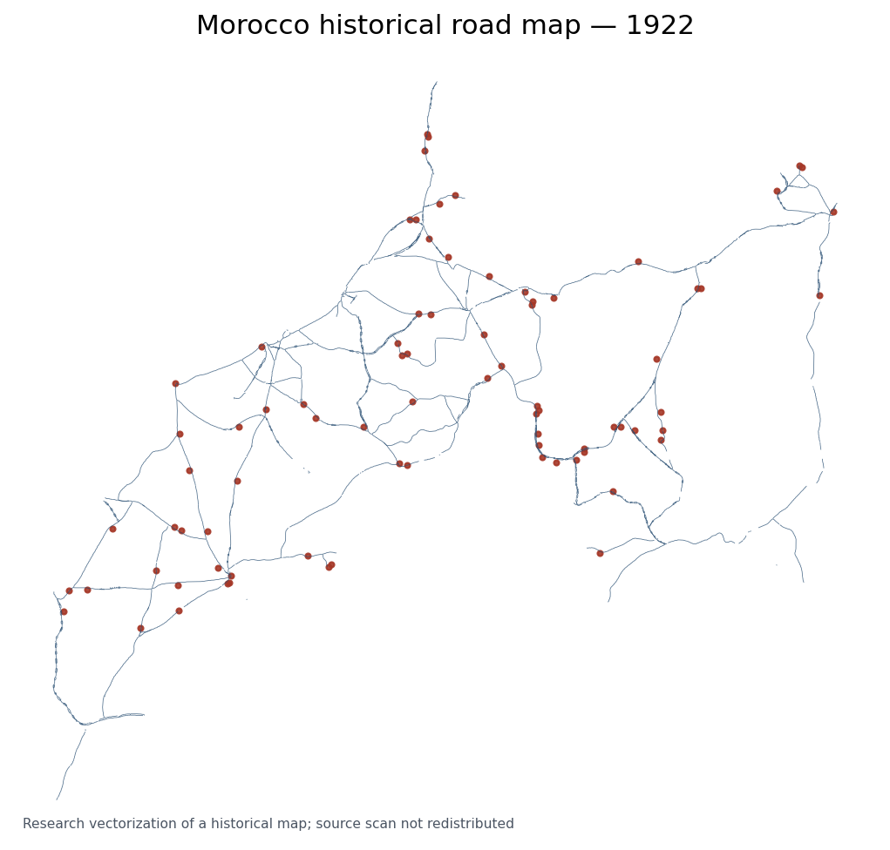
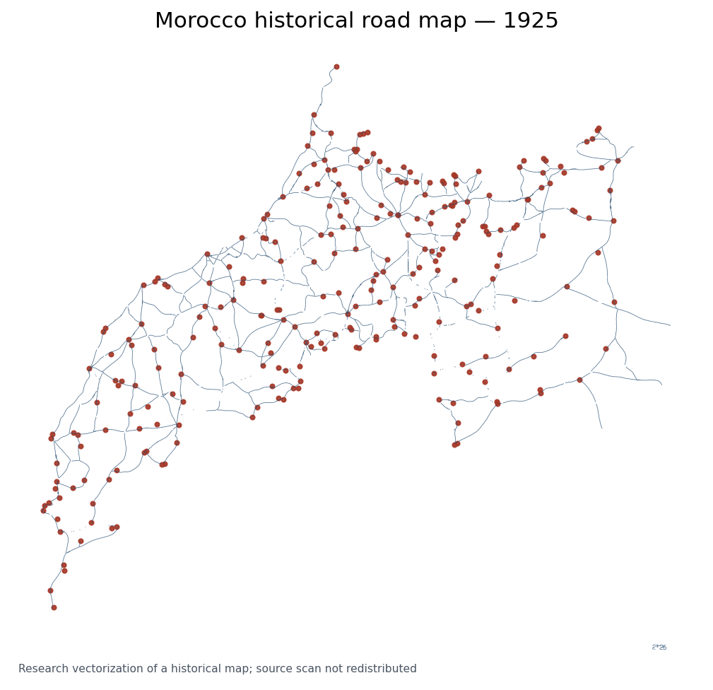
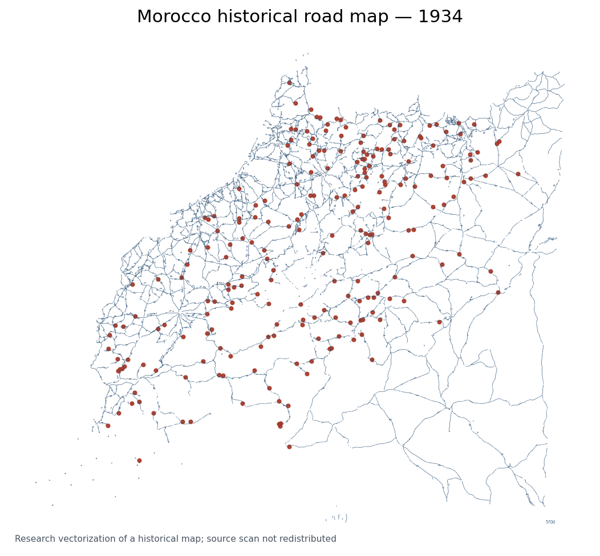
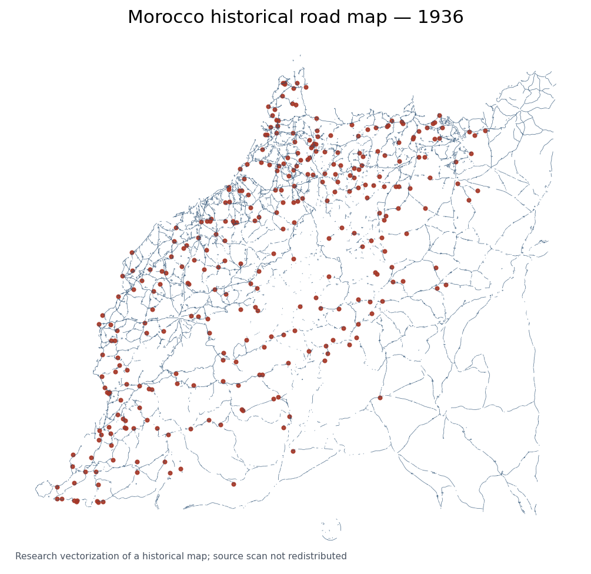
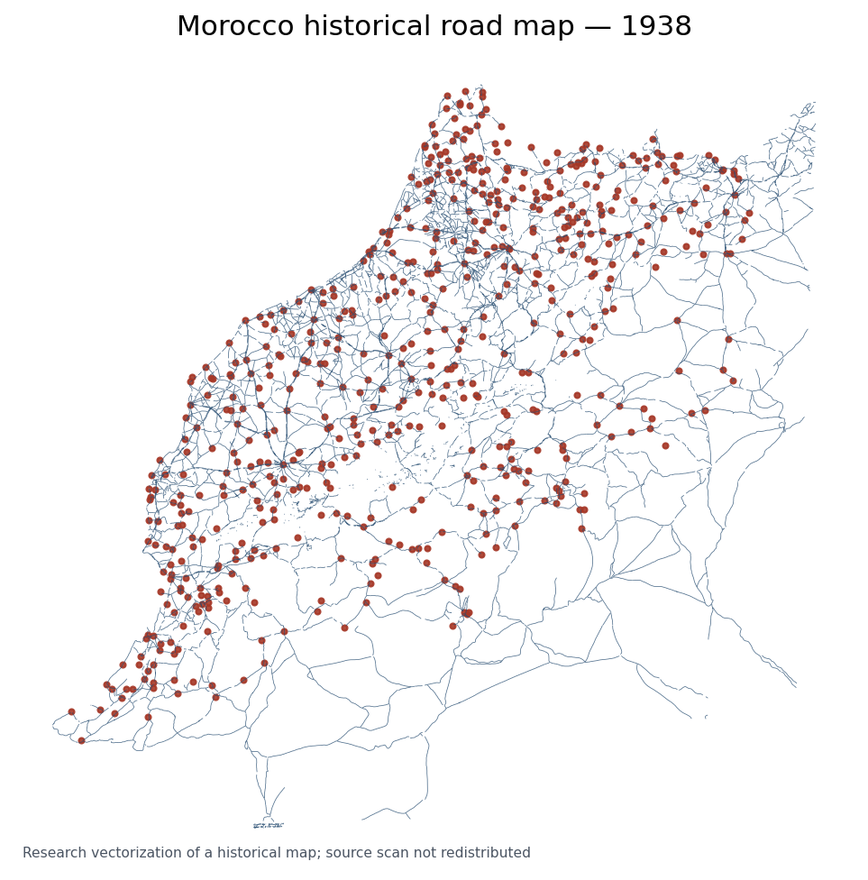

# Morocco historical road maps, 1922–1938

[Version française](README.fr.md)

This research repository publishes a harmonized geographic representation of roads and localities extracted from six historical maps of Morocco: 1922, 1925, 1928, 1934, 1936 and 1938. It is designed to make the retained cartographic products understandable and reusable as a self-contained package.

## What is included

- one GeoPackage containing twelve geographic layers: roads and localities for each year;
- one QGIS project that opens all six years in annual groups;
- a concise scientific overview, data dictionary and source-rights register;
- the scripts and annual settings needed to understand and reproduce the transformations;
- one vector preview per year;
- a manifest linking every public layer to its controlling private source by SHA-256 hash.

The historical source scans, OpenStreetMap extracts, GeoNames dump, embedded Python environment, intermediate files and large raster-bearing GeoPackages are not redistributed in this repository.

## Scientific status

The 1922 map, including its roads, was explicitly validated by the principal investigator. The public layers for 1925 and 1938 combine human-validated objects with automatically classified objects. The 1928, 1934 and 1936 locality inventories remain automatically generated candidates rather than object-by-object human validations. These statuses are carried in the public data and explained in [the scientific overview](docs/SCIENTIFIC_OVERVIEW.md).

The road layer count is a count of vector objects, not a count of historically distinct roads. Some map interruptions are represented by admitted connectors according to the annual rules. The repository does not treat differences in map design, coverage or detection performance as historical change without further analysis.

## Map gallery

| 1922 | 1925 | 1928 |
|---|---|---|
|  |  |  |

| 1934 | 1936 | 1938 |
|---|---|---|
|  |  |  |

## Open the maps

1. Download or clone the repository.
2. Open [MOROCCO_HISTORICAL_MAPS_1922_1938.qgz](qgis/MOROCCO_HISTORICAL_MAPS_1922_1938.qgz) in QGIS 3.44 or a compatible recent version.
3. Enable one or more annual groups. The 1938 group is visible initially.

The project reads [morocco_historical_maps_1922_1938.gpkg](data/morocco_historical_maps_1922_1938.gpkg), which contains all twelve layers and does not require the private source archive.

## Preview

| 1922 | 1925 | 1928 |
|---|---|---|
|  |  |  |

| 1934 | 1936 | 1938 |
|---|---|---|
|  |  |  |

## Documentation

- [Scientific overview](docs/SCIENTIFIC_OVERVIEW.md)
- [Data dictionary](docs/DATA_DICTIONARY.md)
- [Reproducibility guide](docs/REPRODUCIBILITY.md)
- [Sources, rights and attribution](SOURCES_AND_RIGHTS.md)
- [Layer counts and lineage](data/LAYER_SUMMARY.csv)
- [Publication manifest](PUBLICATION_MANIFEST.json)

## Citation and licensing

A citation file is included in [CITATION.cff](CITATION.cff). The final public data and code licences remain to be confirmed before the repository changes from private preparation to public release; see [LICENSE_PENDING.md](LICENSE_PENDING.md). Source-specific attribution requirements are documented separately in [SOURCES_AND_RIGHTS.md](SOURCES_AND_RIGHTS.md).
